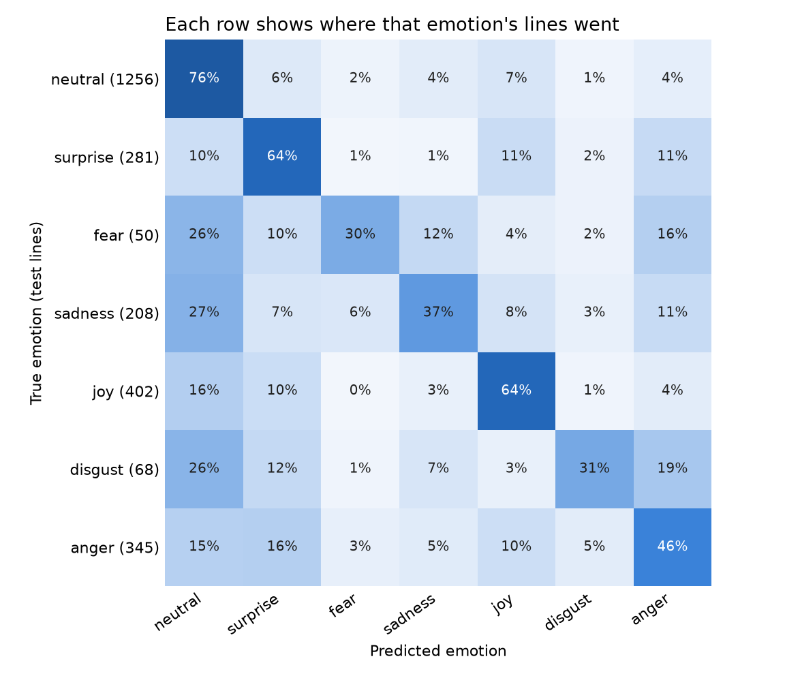
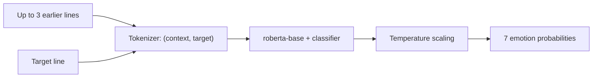

# Emotion recognition in conversation

A text model that reads a line of dialogue with the lines before it and predicts one of seven emotions. It is trained
on [MELD](https://github.com/declare-lab/MELD), and built around one idea: every reported number should be honest.

**Result on 2,610 held-out test lines:** macro-F1 **0.470 ± 0.010**, weighted-F1 **0.627**, accuracy **62.4%**, as the
mean of three seeds. The project's first model scored 0.383, 0.579 and 59.0%.



## Results

| Model | Macro-F1 | Weighted-F1 | Accuracy |
|---|---:|---:|---:|
| Always predict neutral | 0.093 | 0.313 | 48.1% |
| Original baseline: GloVe features and a small classifier | 0.383 | 0.579 | 59.0% |
| **`roberta-base` with the last 3 lines, three-seed mean** | **0.470 ± 0.010** | **0.627 ± 0.007** | **62.4% ± 0.7%** |
| The same three seeds averaged together | 0.486 | 0.641 | 63.8% |

For the three-seed ensemble, the 95% interval from resampling whole dialogues is 0.458–0.514 for macro-F1. Macro-F1
counts all seven emotions equally, so it is the selection metric: always predicting neutral reaches 48% accuracy but
only 0.093 macro-F1.

### Choosing the model

All choices were made on the validation split, with a pass mark for the larger model written down before it ran.

| Design | Validation macro-F1 (3 seeds) |
|---|---:|
| `roberta-base` + last 3 lines | **0.491 ± 0.012** |
| `distilroberta-base` + last 3 lines | 0.452 ± 0.015 |
| `distilroberta-base` + last 3 lines + speaker names | 0.444 ± 0.021 |
| `distilroberta-base` + single line | 0.433 ± 0.009 |

- The larger model's gain over the runner-up is +0.039, with a 95% interval of +0.012 to +0.067.
- Conversation history gained +0.018 on the smaller model. Its interval of -0.001 to +0.038 just includes zero.
- Speaker names showed no measurable benefit.

### Where it goes wrong

From the [error analysis](reports/test/roberta_context3/error_analysis.json) of the ensemble on the test split:

- **Rare emotions collapse into neutral.** 26–27% of fear, sadness and disgust lines are predicted neutral. There are
  only 50 fear lines and 68 disgust lines in the test split, so those scores are also the least certain.
- **Anger is mistaken for surprise** in 16% of anger lines. The two can look alike in text, without tone of voice.
- **Longer lines are harder.** Accuracy falls from 70.3% on lines of 1–3 words to 51.5% on lines of 16 or more.
- **Confidence is useful.** Calibrated confidence error (ECE) fell from 0.140 to 0.037 per seed on test lines:

| Only answer when confidence is at least | Share of lines answered | Accuracy on those lines |
|---:|---:|---:|
| Any | 100% | 63.8% |
| 0.4 | 87.2% | 67.7% |
| 0.6 | 57.4% | 78.9% |
| 0.8 | 23.6% | 88.3% |

So a system that can pass unsure lines to a person gets much higher accuracy on what it keeps. These thresholds were
read from the test split, so they describe this result and are not tuned settings.

## How it works



- **No future leakage.** Context comes only from earlier lines in the same dialogue.
- **The target line is never cut.** When input is too long, only the oldest context words are dropped.
- **Class imbalance:** cross-entropy weighted by inverse square root of class frequency, from training data only.
- **Training:** AdamW at 2e-5, 10% warmup, gradient clipping at 1.0, 4 rounds, best round chosen by validation macro-F1.
- **Calibration:** one temperature per seed, fitted on validation logits.
- **Model pinning:** each run records the exact model commit, so it can be repeated if the upstream model changes.

## Evaluation rules

- Models, rounds and designs are chosen on validation only.
- `meld-evaluate` refuses to read the test split without `--final`, and logs each use in
  [`reports/test_ledger.json`](reports/test_ledger.json).
- The headline test figure and the ensemble comparison were fixed in writing before the test split was read.
- Results are reported across seeds 42, 7 and 123, with intervals from resampling whole dialogues, because lines from
  one dialogue are related.

The full history, including failed runs and every disclosure, is in the
[experiment log](docs/experiment_log.md).

## Engineering notes

This was trained on an 8 GB M1 MacBook, which shaped the code:

- Long context inputs caused memory thrashing on the Mac GPU, so training uses gradient accumulation.
- The Mac GPU also produced invalid loss values under memory pressure. Invalid batches are skipped and counted, and
  training stops if they repeat.
- A measured comparison then showed the CPU was over three times faster here, so the final runs used the CPU.
- Each round writes an atomic checkpoint, so a stopped run continues from its last finished round.

## Run it

Requires Python 3.11.

```bash
python3.11 -m venv .venv
source .venv/bin/activate
pip install -e ".[dev,serve,analysis]"
pytest
```

The tests use small generated data, so they need no download.

### Data

MELD is not included. Copy `train_sent_emo.csv`, `dev_sent_emo.csv` and `test_sent_emo.csv` from
[`data/MELD/`](https://github.com/declare-lab/MELD/tree/master/data/MELD) in the official repository to `data/raw/`.
Their SHA-256 hashes are checked when read.

### Train and compare

Trained weights are not distributed. One seed takes about 75 minutes on an M1 CPU.

```bash
meld-train --config configs/roberta_context3.json --seed 42 --device cpu
meld-compare
```

### Predict

```bash
meld-predict --run artifacts/roberta_context3/seed_123 --speaker Sam --text "You did WHAT with my car?" \
  --context "Alex:I have to tell you something." --context "Alex:I sold it this morning."
```

For that invented example, the model answers `surprise` with confidence 0.77.

### Serve

```bash
MELD_RUN=artifacts/roberta_context3/seed_123 uvicorn meld_emotion.api:app --port 8000
```

```bash
curl -s localhost:8000/predict -H 'content-type: application/json' \
  -d '{"line": {"text": "You did WHAT with my car?", "speaker": "Sam"}, "context": [{"text": "I sold it this morning.", "speaker": "Alex"}]}'
```

Or with Docker, mounting a saved run:

```bash
docker build -t meld-emotion .
docker run --rm -p 8000:8000 -v "$PWD/artifacts/roberta_context3/seed_123:/model:ro" meld-emotion
```

The service loads one seed. The ensemble figures above need all three.

## Repository layout

```text
src/meld_emotion/     data, training, evaluation, prediction and the API
configs/              one file per experiment design
tests/                automatic checks, including leakage and training behaviour
scripts/              workflow runner, validation records, error analysis, training dashboard
reports/              saved results, the test ledger and run logs
docs/                 experiment log
experiments/baselines/ the archived first stage, with its own README
```

## Limits

- The test split is not perfectly fresh. The project's first models were scored on it once before this work began.
- Four designs were compared on one validation set, and validation-to-test macro-F1 fell by 0.021.
- Text only: tone of voice and facial expression are not used. Published multimodal systems report higher scores, and
  those results may use different setups, so they are not directly comparable.
- MELD is scripted dialogue from one TV show. These scores do not show how the model behaves on real conversations.
- See the [model card](MODEL_CARD.md) for intended use.

## Data and licence

The code is released under [GPL-3.0](LICENSE), matching the licence of the MELD repository. This repository contains
no MELD data or trained weights. If you use MELD, please cite:

- S. Poria, D. Hazarika, N. Majumder, G. Naik, E. Cambria, R. Mihalcea. *MELD: A Multimodal Multi-Party Dataset for
  Emotion Recognition in Conversation.* ACL 2019.
- S.Y. Chen, C.C. Hsu, C.C. Kuo, L.W. Ku. *EmotionLines: An Emotion Corpus of Multi-Party Conversations.*
  arXiv:1802.08379, 2018.
